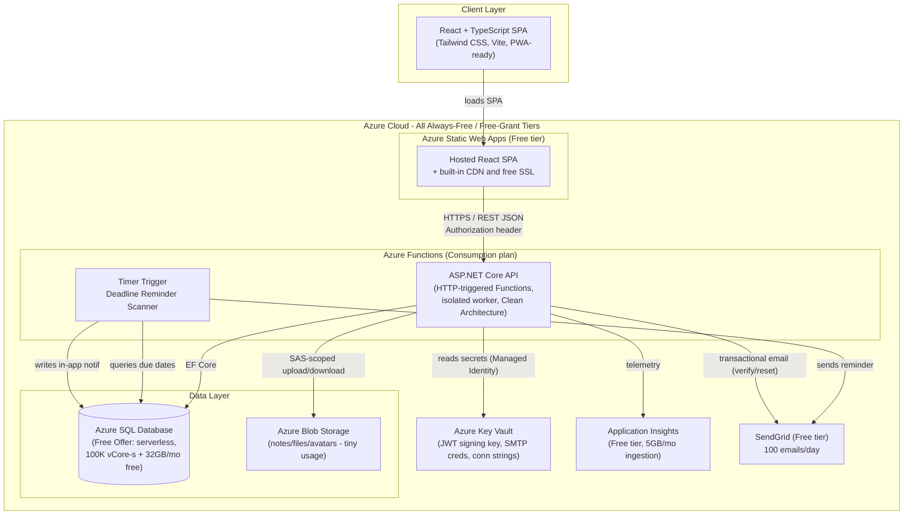
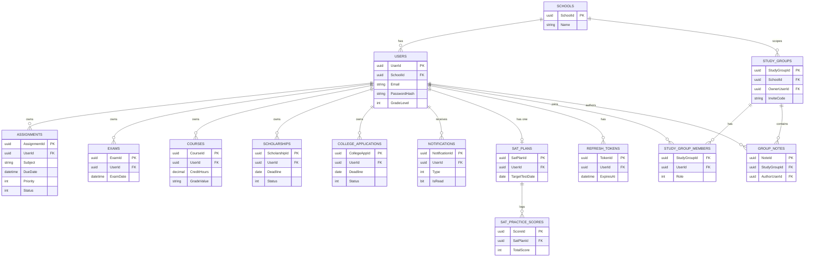
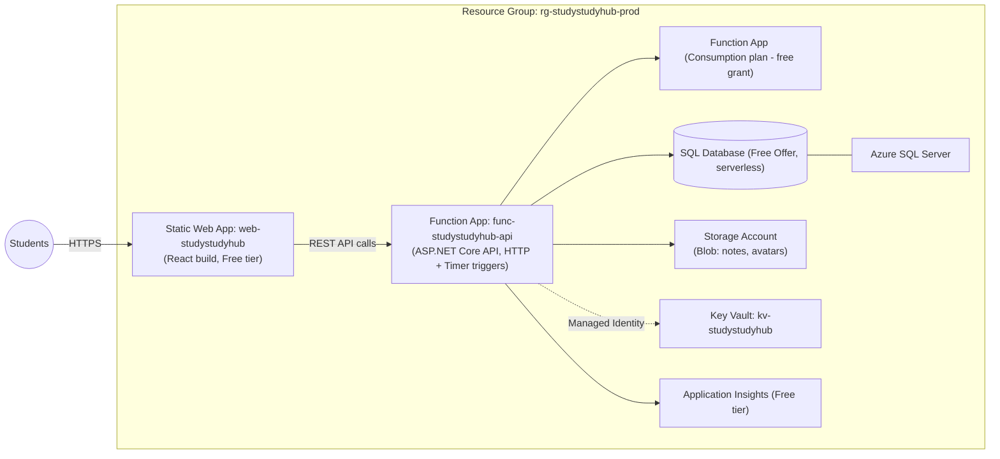

# Student Study Hub — Full Design Package

**Decisions locked:** Custom JWT auth · School-scoped study groups · Responsive web only (MVP) · In-app + email notifications · No AI (v1) · **$0/month Azure "Always Free" tier** (Azure Functions API + Static Web Apps + SQL free offer + App Insights free tier, via Azure for Students) · Solo developer, 2–3 month MVP, portfolio project.

> **Cost update (v1.1):** Architecture revised to run on **Azure's Always-Free tiers** (not just low-cost paid tiers), funded by the **Azure for Students** offer ($100 credit, no credit card required, 12 months) and services that remain free indefinitely afterward. See Section 13 for details.

---

## 1. Product Requirements Document (PRD)

### 1.1 Vision
A mobile-first web app that becomes a high schooler's single source of truth for academics: assignments, study groups, notes, exams, GPA, SAT prep, scholarships, and college applications — reducing the 6+ apps/notebooks students currently juggle.

### 1.2 Problem Statement
High schoolers track homework in one app, study with classmates over group chats with lost files, calculate GPA by hand, track SAT prep in a notebook, and manage scholarship/college deadlines in scattered spreadsheets. No single tool owns the "student academic life" workflow end-to-end for this age group.

### 1.3 Goals (v1 / MVP)
- G1: Student can sign up, verify email, and manage a profile tied to a School.
- G2: Student can track assignments with due dates, subjects, priority, and completion status.
- G3: Student can create/join a School-scoped Study Group and share notes within it.
- G4: Student sees a unified Exam/Quiz countdown dashboard.
- G5: Student can compute weighted/unweighted GPA from courses + grades.
- G6: Student can plan SAT study sessions against a target test date.
- G7: Student can track scholarships (deadlines, status, requirements).
- G8: Student can track college applications (deadlines, status, requirements).
- G9: Student sees everything on a unified Calendar.
- G10: Student receives in-app + email reminders for upcoming deadlines.

### 1.4 Non-Goals (v1)
- Native mobile apps (iOS/Android) — future.
- AI recommendations/summarization — future.
- Teacher/parent portals — future.
- Real-time chat/video in study groups — future (start with shared notes + files only).
- Multi-tenant SSO with real school IT systems — future (Entra ID swap-in later).

### 1.5 Success Metrics
- Activation: % of signups who add ≥1 assignment within 24h.
- Retention: Weekly active users returning in week 2.
- Engagement: Avg. # of study groups joined per active user.
- Reliability: 99.5% uptime (Basic tier target), P95 API latency < 500ms.

---

## 2. User Personas

**1. Priya, 16, Sophomore ("The Overcommitted Achiever")**
Honors classes + 3 clubs + SAT prep starting. Needs: single dashboard, GPA tracking, SAT countdown. Pain: forgets assignment due dates buried in 5 different class portals.

**2. Marcus, 17, Junior ("The College-Bound Planner")**
Building a college list, applying for scholarships, tracking application deadlines. Needs: college + scholarship tracker with status pipelines. Pain: spreadsheet chaos, missed scholarship deadlines.

**3. Dana, 15, Freshman ("The Social Studier")**
Learns best in groups, struggles with organization. Needs: easy study group creation, shared notes. Pain: group chat notes get lost, no central place for shared class notes.

**4. Alex, 18, Senior ("The Last-Mile Senior")**
Juggling senior-year workload + final college apps + scholarship deadlines simultaneously. Needs: unified calendar view across all deadline types. Pain: deadline fatigue, missed important dates.

---

## 3. User Stories (sample, by epic)

**Auth/Profile**
- As a student, I can register with email/password and select my school, so my study groups are scoped correctly.
- As a student, I can verify my email, so my account is confirmed authentic.
- As a student, I can edit my profile (grade level, avatar, bio), so it reflects who I am.

**Assignments**
- As a student, I can create an assignment with subject, due date, priority, and status, so I can track my workload.
- As a student, I can mark an assignment complete, so my dashboard reflects real progress.
- As a student, I can filter assignments by subject/status/due date, so I can focus on what's urgent.

**Study Groups**
- As a student, I can create a study group within my school, so classmates can join via invite code.
- As a student, I can join a study group using an invite code, so I can collaborate with classmates.
- As a group member, I can upload/share notes in a group, so everyone benefits from shared material.
- As a group owner, I can remove a member or delete the group, so I control group integrity.

**Exams**
- As a student, I can add an exam/quiz with date and subject, so it shows on my countdown dashboard.
- As a student, I see exams sorted by "days remaining," so I know what to prioritize.

**GPA Calculator**
- As a student, I can add courses with credit hours, grade, and weight (honors/AP), so I get an accurate GPA.
- As a student, I can see both weighted and unweighted GPA, so I can report either as needed.

**SAT Planner**
- As a student, I can set a target SAT date and score goal, so a study plan is scaffolded.
- As a student, I can log practice test scores, so I can see score trend over time.

**Scholarships**
- As a student, I can add a scholarship with deadline, amount, and requirements checklist, so I track application progress.
- As a student, I can mark a scholarship's status (Researching/Applying/Submitted/Awarded/Rejected).

**College Applications**
- As a student, I can add a college with application deadline, type (ED/EA/RD), and required materials, so I track progress per school.

**Calendar**
- As a student, I can view assignments, exams, scholarship deadlines, and college deadlines in one calendar, so I never miss a date.

**Notifications**
- As a student, I receive an in-app + email reminder 3 days and 1 day before a deadline, so I don't forget.

---

## 4. Functional Requirements

| ID | Requirement |
|----|-------------|
| FR-1 | System shall support registration, login, logout, email verification, and password reset via JWT. |
| FR-2 | System shall associate each student with exactly one School (selected at signup from a managed list, or "Other"). |
| FR-3 | System shall support CRUD for Assignments (subject, title, description, due date, priority, status). |
| FR-4 | System shall support CRUD for Study Groups, scoped to the creator's School, with invite-code join. |
| FR-5 | System shall support file/note sharing within a Study Group (text notes + file upload to Blob Storage). |
| FR-6 | System shall support CRUD for Exams/Quizzes and display a sorted countdown dashboard. |
| FR-7 | System shall calculate weighted and unweighted GPA from user-entered Courses/Grades. |
| FR-8 | System shall support an SAT study plan: target date, goal score, practice test score log. |
| FR-9 | System shall support CRUD for Scholarships with status pipeline and deadline tracking. |
| FR-10 | System shall support CRUD for College Applications with status pipeline and deadline tracking. |
| FR-11 | System shall render a unified calendar aggregating all date-bound entities. |
| FR-12 | System shall send in-app notifications and scheduled email reminders for upcoming deadlines. |
| FR-13 | System shall enforce that a user can only access/modify their own data or data of groups they belong to. |

## 5. Non-Functional Requirements

| Category | Requirement |
|---|---|
| Performance | P95 API response < 500ms under normal load; dashboard loads < 2s on 4G mobile. |
| Scalability | Stateless API on Azure Functions Consumption plan; scales out automatically within free-grant execution limits, can move to Premium plan later without code changes. |
| Availability | Target 99%+ uptime (Consumption plan has cold starts after idle, acceptable for MVP/portfolio traffic); graceful degradation if email service fails. |
| Security | OWASP ASVS L1 baseline; JWT access+refresh tokens; bcrypt/Argon2 password hashing; TLS everywhere; secrets in Key Vault. |
| Usability | Mobile-first responsive (320px–1440px); WCAG 2.1 AA color contrast; max 2 taps to core actions. |
| Maintainability | Clean Architecture layering; >70% unit test coverage on domain/application layers. |
| Data Privacy | COPPA/FERPA-aware: minimal PII, parental consent messaging for <18 users (educational note, not legal certification), data export/delete on request. |
| Observability | Application Insights: request tracing, exception logging, custom events for key funnels (free tier, 5GB/month ingestion). |
| Cost | **$0/month target**: Azure Functions Consumption (API), Azure Static Web Apps Free tier (frontend), Azure SQL Database Free Offer, App Insights free tier, SendGrid free tier — funded/bootstrapped via Azure for Students. |

---

## 6. System Architecture Diagram



**Key decisions:**
- **Modular Monolith on Azure Functions**: one ASP.NET Core codebase (isolated worker model) with HTTP-triggered Functions replacing Controllers, clearly separated modules (Assignments, Groups, Exams, GPA, SAT, Scholarships, Colleges). Avoids microservices overhead inappropriate for a solo dev; Functions Consumption plan gives 1M free executions + 400,000 GB-s/month forever, comfortably covering MVP/portfolio traffic at $0.
- **Azure Function (Timer Trigger)** handles scheduled deadline-reminder scans in the same Function App, so reminder logic runs serverlessly alongside the API at no extra cost.
- **Blob Storage** for shared notes/files keeps large binary data out of SQL (cost + performance); usage at this scale costs pennies, covered by free credit.
- **Trade-off accepted**: Consumption-plan cold starts (a few seconds after idle) are acceptable for a portfolio/MVP app; can upgrade to Premium plan later for zero cold-start without changing code.
- **Blob Storage** for shared notes/files keeps large binary data out of SQL (cost + performance).

---

## 7. Database Design (Relational Schema)

### Core Tables

```
Schools
  SchoolId (PK, uniqueidentifier)
  Name (nvarchar200)
  City, State
  CreatedAt

Users
  UserId (PK, uniqueidentifier)
  SchoolId (FK -> Schools, nullable until onboarding complete)
  Email (unique, nvarchar256)
  PasswordHash (nvarchar)
  FirstName, LastName
  GradeLevel (tinyint: 9-12)
  AvatarUrl (nvarchar, nullable)
  EmailVerified (bit)
  CreatedAt, UpdatedAt

RefreshTokens
  TokenId (PK)
  UserId (FK)
  TokenHash
  ExpiresAt
  CreatedByIp
  RevokedAt (nullable)

Assignments
  AssignmentId (PK)
  UserId (FK)
  Subject (nvarchar100)
  Title (nvarchar200)
  Description (nvarchar(max), nullable)
  DueDate (datetime2)
  Priority (tinyint: Low/Med/High)
  Status (tinyint: NotStarted/InProgress/Done)
  CreatedAt, UpdatedAt

StudyGroups
  StudyGroupId (PK)
  SchoolId (FK)
  OwnerUserId (FK -> Users)
  Name (nvarchar150)
  Subject (nvarchar100, nullable)
  InviteCode (unique, char8)
  CreatedAt

StudyGroupMembers
  StudyGroupId (FK)
  UserId (FK)
  Role (tinyint: Owner/Member)
  JoinedAt
  PRIMARY KEY (StudyGroupId, UserId)

GroupNotes
  NoteId (PK)
  StudyGroupId (FK)
  AuthorUserId (FK)
  Title (nvarchar200)
  Content (nvarchar(max), nullable)       -- markdown/text notes
  FileBlobUrl (nvarchar, nullable)        -- optional attached file
  CreatedAt, UpdatedAt

Exams
  ExamId (PK)
  UserId (FK)
  Subject (nvarchar100)
  Title (nvarchar200)
  ExamDate (datetime2)
  Type (tinyint: Quiz/Exam/Final)
  Notes (nvarchar(max), nullable)

Courses
  CourseId (PK)
  UserId (FK)
  Name (nvarchar150)
  CreditHours (decimal 3,1)
  GradeValue (nvarchar5)            -- "A", "B+", etc.
  IsHonorsOrAP (bit)
  Term (nvarchar50)                 -- "Fall 2025"

SatPlans
  SatPlanId (PK)
  UserId (FK, unique)               -- one active plan per user
  TargetTestDate (date)
  GoalScore (smallint)
  CreatedAt

SatPracticeScores
  ScoreId (PK)
  SatPlanId (FK)
  TestDate (date)
  ReadingWritingScore (smallint)
  MathScore (smallint)
  TotalScore (smallint, computed or stored)

Scholarships
  ScholarshipId (PK)
  UserId (FK)
  Name (nvarchar200)
  Amount (decimal 10,2, nullable)
  Deadline (date)
  Status (tinyint: Researching/Applying/Submitted/Awarded/Rejected)
  RequirementsJson (nvarchar(max), nullable)  -- simple checklist as JSON

CollegeApplications
  CollegeAppId (PK)
  UserId (FK)
  CollegeName (nvarchar200)
  ApplicationType (tinyint: ED/EA/RD/Rolling)
  Deadline (date)
  Status (tinyint: NotStarted/InProgress/Submitted/Accepted/Rejected/Waitlisted)
  RequirementsJson (nvarchar(max), nullable)

Notifications
  NotificationId (PK)
  UserId (FK)
  Type (tinyint: AssignmentDue/ExamSoon/ScholarshipDeadline/CollegeDeadline/GroupActivity)
  Title (nvarchar200)
  Body (nvarchar500)
  RelatedEntityId (uniqueidentifier, nullable)
  IsRead (bit)
  SentViaEmail (bit)
  CreatedAt
```

### Indexing notes
- `Users.Email` unique index.
- `StudyGroups.InviteCode` unique index.
- Composite index `(UserId, DueDate)` on Assignments/Exams/Scholarships/CollegeApplications for fast "upcoming" queries.
- `Notifications (UserId, IsRead, CreatedAt DESC)` for the notification bell query.

---

## 8. Entity Relationship Diagram



---

## 9. REST API Design

Base URL: `/api/v1`. All endpoints (except `/auth/*`) require `Authorization: Bearer <access_token>`.

### Auth
| Method | Route | Description |
|---|---|---|
| POST | `/auth/register` | Create account (email, password, firstName, lastName, schoolId, gradeLevel) |
| POST | `/auth/login` | Returns access token (15min) + refresh token (httpOnly cookie or body, 7d) |
| POST | `/auth/refresh` | Exchange refresh token for new access token |
| POST | `/auth/logout` | Revoke refresh token |
| POST | `/auth/verify-email` | Confirm email via token |
| POST | `/auth/forgot-password` | Send reset email |
| POST | `/auth/reset-password` | Reset via token |

### Users / Profile
| Method | Route | Description |
|---|---|---|
| GET | `/users/me` | Current profile |
| PUT | `/users/me` | Update profile |
| GET | `/schools?search=` | Search schools for onboarding dropdown |

### Assignments
| Method | Route | Description |
|---|---|---|
| GET | `/assignments?status=&subject=&sort=` | List (filterable) |
| POST | `/assignments` | Create |
| GET | `/assignments/{id}` | Detail |
| PUT | `/assignments/{id}` | Update |
| PATCH | `/assignments/{id}/status` | Quick status toggle |
| DELETE | `/assignments/{id}` | Delete |

### Study Groups
| Method | Route | Description |
|---|---|---|
| GET | `/study-groups/mine` | Groups I belong to |
| POST | `/study-groups` | Create (auto-scoped to my school) |
| POST | `/study-groups/join` | Join via `{ inviteCode }` |
| GET | `/study-groups/{id}` | Detail + members |
| DELETE | `/study-groups/{id}` | Delete (owner only) |
| DELETE | `/study-groups/{id}/members/{userId}` | Remove member (owner only) |
| GET | `/study-groups/{id}/notes` | List notes |
| POST | `/study-groups/{id}/notes` | Create note (text and/or file) |
| POST | `/study-groups/{id}/notes/{noteId}/attachment` | Upload file (returns Blob SAS URL) |
| DELETE | `/study-groups/{id}/notes/{noteId}` | Delete note (author/owner) |

### Exams
| Method | Route | Description |
|---|---|---|
| GET | `/exams?upcoming=true` | List, sorted by countdown |
| POST | `/exams` | Create |
| PUT | `/exams/{id}` | Update |
| DELETE | `/exams/{id}` | Delete |

### GPA / Courses
| Method | Route | Description |
|---|---|---|
| GET | `/courses?term=` | List courses |
| POST | `/courses` | Add course |
| PUT | `/courses/{id}` | Update |
| DELETE | `/courses/{id}` | Delete |
| GET | `/gpa/summary` | Returns `{ weightedGpa, unweightedGpa, totalCredits }` |

### SAT Planner
| Method | Route | Description |
|---|---|---|
| GET | `/sat-plan` | Get my plan (incl. scores) |
| POST | `/sat-plan` | Create/update target date + goal |
| POST | `/sat-plan/scores` | Log practice test score |

### Scholarships
| Method | Route | Description |
|---|---|---|
| GET | `/scholarships?status=` | List |
| POST | `/scholarships` | Create |
| PUT | `/scholarships/{id}` | Update |
| DELETE | `/scholarships/{id}` | Delete |

### College Applications
| Method | Route | Description |
|---|---|---|
| GET | `/college-applications?status=` | List |
| POST | `/college-applications` | Create |
| PUT | `/college-applications/{id}` | Update |
| DELETE | `/college-applications/{id}` | Delete |

### Calendar
| Method | Route | Description |
|---|---|---|
| GET | `/calendar?from=&to=` | Aggregated events across all entity types |

### Notifications
| Method | Route | Description |
|---|---|---|
| GET | `/notifications?unreadOnly=` | List |
| PATCH | `/notifications/{id}/read` | Mark read |
| PATCH | `/notifications/read-all` | Mark all read |

**Conventions:** camelCase JSON, pagination via `?page=&pageSize=` returning `{ items, totalCount, page, pageSize }`, errors as RFC 7807 `application/problem+json`, versioned via URL segment `v1`.

---

## 10. Backend Folder Structure (ASP.NET Core, Clean Architecture)

```
StudentStudyHub.Api/
├── src/
│   ├── StudentStudyHub.Domain/              # Entities, enums, domain logic, no dependencies
│   │   ├── Entities/
│   │   │   ├── User.cs, School.cs, Assignment.cs, StudyGroup.cs,
│   │   │   │   StudyGroupMember.cs, GroupNote.cs, Exam.cs, Course.cs,
│   │   │   │   SatPlan.cs, SatPracticeScore.cs, Scholarship.cs,
│   │   │   │   CollegeApplication.cs, Notification.cs, RefreshToken.cs
│   │   ├── Enums/ (Priority, Status, ApplicationType, NotificationType...)
│   │   ├── Common/ (BaseEntity, IAggregateRoot)
│   │   └── Exceptions/ (DomainException, NotFoundException)
│   │
│   ├── StudentStudyHub.Application/         # Use cases, CQRS handlers, DTOs, validation
│   │   ├── Common/Interfaces/ (IAppDbContext, ICurrentUserService, IDateTimeProvider,
│   │   │   IEmailService, IBlobStorageService, IJwtTokenService)
│   │   ├── Common/Behaviors/ (ValidationBehavior, LoggingBehavior - MediatR pipeline)
│   │   ├── Auth/ (Commands: Register, Login, RefreshToken, VerifyEmail, ResetPassword)
│   │   ├── Assignments/ (Commands, Queries, Validators, Dtos)
│   │   ├── StudyGroups/ (Commands, Queries, Validators, Dtos)
│   │   ├── Exams/ ...
│   │   ├── Gpa/ ...
│   │   ├── SatPlanner/ ...
│   │   ├── Scholarships/ ...
│   │   ├── CollegeApplications/ ...
│   │   ├── Calendar/ (CQRS query aggregating multiple entities)
│   │   └── Notifications/ ...
│   │
│   ├── StudentStudyHub.Infrastructure/       # EF Core, external services
│   │   ├── Persistence/
│   │   │   ├── ApplicationDbContext.cs
│   │   │   ├── Configurations/ (EF Fluent API per entity)
│   │   │   └── Migrations/
│   │   ├── Services/ (JwtTokenService, EmailService (SendGrid/ACS),
│   │   │   BlobStorageService, DateTimeProvider)
│   │   ├── Identity/ (PasswordHasher wrapper)
│   │   └── DependencyInjection.cs
│   │
│   └── StudentStudyHub.Functions/            # Presentation layer: Azure Functions (isolated worker)
│       ├── Http/ (AuthFunctions, AssignmentsFunctions,
│       │   StudyGroupsFunctions, ExamsFunctions, GpaFunctions,
│       │   SatPlanFunctions, ScholarshipsFunctions,
│       │   CollegeApplicationsFunctions, CalendarFunctions,
│       │   NotificationsFunctions, UsersFunctions, SchoolsFunctions)
│       │   # each class = one Function App "module", HTTP-triggered endpoints
│       │   # grouped by feature, mirroring the old Controllers
│       ├── Timers/
│       │   └── DeadlineReminderFunction.cs   # Timer-triggered (e.g., hourly) reminder scanner
│       ├── Middleware/ (ExceptionHandlingMiddleware, JwtAuthMiddleware — custom middleware pipeline
│       │   for isolated worker model)
│       ├── Extensions/ (ServiceCollectionExtensions, SwaggerExtensions via Microsoft.Azure.Functions.Worker.Extensions.OpenApi)
│       ├── host.json / local.settings.json
│       └── Program.cs                        # FunctionsApplicationBuilder host setup
│
├── tests/
│   ├── StudentStudyHub.Domain.UnitTests/
│   ├── StudentStudyHub.Application.UnitTests/
│   └── StudentStudyHub.Functions.IntegrationTests/ (in-process test host + SQL LocalDB/Azurite emulator)
│
├── StudentStudyHub.sln
└── Directory.Build.props
```

**Why Clean Architecture + CQRS (MediatR), now on Azure Functions**: Domain/Application/Infrastructure layers are **unchanged** from the App Service design — only the Presentation layer swaps ASP.NET Core Controllers for Azure Functions HTTP triggers (isolated worker model, which fully supports dependency injection, MediatR, and middleware). This keeps business logic testable and framework-agnostic while getting the Functions Consumption plan's free-forever execution grant (1M executions/month). Each feature folder (vertical slice) stays easy to extend solo without architectural debt as features grow (9 core feature domains).

---

## 11. Frontend Folder Structure (React + TypeScript + Tailwind)

```
student-study-hub-web/
├── public/
│   ├── manifest.json        # PWA manifest (installable on mobile)
│   └── icons/
├── src/
│   ├── app/
│   │   ├── App.tsx
│   │   ├── router.tsx                  # React Router route tree
│   │   └── providers/ (QueryClientProvider, AuthProvider, ToastProvider)
│   │
│   ├── pages/
│   │   ├── auth/ (LoginPage, RegisterPage, VerifyEmailPage, ForgotPasswordPage)
│   │   ├── dashboard/ (DashboardPage)
│   │   ├── assignments/ (AssignmentsListPage, AssignmentDetailPage)
│   │   ├── study-groups/ (GroupsListPage, GroupDetailPage, JoinGroupPage)
│   │   ├── exams/ (ExamsCountdownPage)
│   │   ├── gpa/ (GpaCalculatorPage)
│   │   ├── sat/ (SatPlannerPage)
│   │   ├── scholarships/ (ScholarshipsPage)
│   │   ├── colleges/ (CollegeAppsPage)
│   │   ├── calendar/ (CalendarPage)
│   │   └── profile/ (ProfilePage)
│   │
│   ├── features/                       # feature-sliced business logic + API hooks
│   │   ├── auth/ (api.ts, hooks.ts, types.ts, authSlice or AuthContext)
│   │   ├── assignments/ (api.ts, hooks.ts [useAssignments, useCreateAssignment], types.ts)
│   │   ├── studyGroups/ ...
│   │   ├── exams/ ...
│   │   ├── gpa/ ...
│   │   ├── sat/ ...
│   │   ├── scholarships/ ...
│   │   ├── colleges/ ...
│   │   ├── calendar/ ...
│   │   └── notifications/ ...
│   │
│   ├── components/
│   │   ├── ui/ (Button, Input, Select, Modal, Card, Badge, Tabs, Spinner — design system primitives)
│   │   ├── layout/ (AppShell, BottomNavBar [mobile], Sidebar [desktop], TopBar, NotificationBell)
│   │   └── shared/ (EmptyState, CountdownBadge, DeadlinePill, StatusChip)
│   │
│   ├── lib/
│   │   ├── apiClient.ts                # axios/fetch wrapper, attaches JWT, handles 401 refresh
│   │   ├── queryClient.ts              # TanStack Query config
│   │   └── utils/ (dateUtils.ts, gpaUtils.ts, validators.ts)
│   │
│   ├── hooks/ (useAuth.ts, useMediaQuery.ts, useDebounce.ts)
│   ├── types/ (shared global types, api response envelopes)
│   ├── styles/ (tailwind.css, theme tokens)
│   ├── main.tsx
│   └── vite-env.d.ts
│
├── tests/
│   ├── unit/ (Vitest + React Testing Library)
│   └── e2e/ (Playwright)
│
├── tailwind.config.ts
├── vite.config.ts
├── tsconfig.json
└── package.json
```

**Why feature-sliced + TanStack Query**: each of the 9 feature domains stays self-contained (api calls, cache, types together); TanStack Query gives caching/retries/optimistic updates for free, important for a solo dev needing speed.

---

## 12. Security Design

- **Password storage**: BCrypt (work factor 12) or ASP.NET Core Identity's PasswordHasher (PBKDF2) — never custom crypto.
- **JWT strategy**: short-lived access token (15 min, RS256 signed), rotating refresh token (7–30 days) stored as httpOnly, Secure, SameSite=Strict cookie; refresh tokens hashed at rest, revocable (logout invalidates), reuse-detection (if an old refresh token is replayed, revoke the whole token family).
- **Secrets**: JWT signing key, DB connection string, SendGrid/ACS API key, Blob Storage connection string all stored in **Azure Key Vault**; API reads via Managed Identity (no secrets in appsettings.json or source control).
- **Transport**: HTTPS enforced (HSTS), TLS 1.2+ only.
- **Authorization**: resource-based checks in Application layer (e.g., `AssignmentOwnerRequirement`) — users can only read/write their own Assignments/Exams/Courses/Scholarships/CollegeApplications; Study Group actions check membership/ownership.
- **Input validation**: FluentValidation on every command DTO; EF Core parameterized queries (no raw SQL) prevents SQL injection.
- **Rate limiting**: ASP.NET Core built-in rate limiter on `/auth/*` endpoints (prevent brute force) — e.g., 5 login attempts / minute / IP.
- **CORS**: locked to the deployed frontend origin only.
- **File uploads**: validated content-type/size (e.g., ≤10MB, PDF/DOCX/PNG/JPG only), stored in Blob with private container + short-lived SAS tokens for access, scanned extension allowlist to reduce malicious upload risk.
- **Data privacy**: since users may be minors (14–18), collect only necessary PII, include a plain-language privacy notice, support account data export/delete endpoints.
- **Dependency hygiene**: Dependabot/`dotnet list package --vulnerable` + `npm audit` in CI.
- **Logging**: never log passwords/tokens; Application Insights with PII scrubbing on request bodies.

---

## 13. Deployment Architecture on Azure ($0/Month Free Tier)



- **Frontend hosting**: Azure Static Web Apps **Free tier** — built-in CDN, free managed SSL, custom domain support, native GitHub Actions integration. **$0 forever.**
- **API + reminders**: single **Azure Function App on the Consumption plan** hosting both HTTP-triggered endpoints (replacing the API) and the Timer-triggered reminder scanner. Free grant: **1,000,000 executions + 400,000 GB-s/month, forever** — comfortably covers MVP/portfolio traffic. **$0.**
- **Database**: **Azure SQL Database Free Offer** — one free serverless database per Azure subscription, auto-pauses when idle, includes 100,000 vCore-seconds + 32GB storage per month at no cost. **$0 within those limits** (well above this app's expected usage).
- **Storage Account**: Standard LRS Blob Storage for notes/files/avatars — usage at this scale costs a few cents/month, covered by the Azure for Students $100 credit.
- **Key Vault**: Standard tier, pay-per-operation (~$0.03 per 10,000 operations) — negligible, covered by credit.
- **Application Insights**: **Free tier**, up to 5GB/month ingestion — sufficient for MVP traffic. **$0.**
- **Email**: **SendGrid Free tier** (100 emails/day) for verification, password reset, and deadline reminder emails. **$0.**
- **Custom domain + TLS**: free managed certificate via Static Web Apps.
- **Funding**: activate **Azure for Students** (school email, no credit card required) for the $100/12-month credit covering any non-"Always Free" usage (Blob Storage, Key Vault ops) — in practice this app should stay at or near **$0/month** even after the 12 months, since the core services (Functions, SWA, SQL Free Offer, App Insights) remain free indefinitely.
- **Trade-offs accepted for $0 cost**: Functions Consumption plan has cold starts after ~20 min idle (a few seconds of added latency on first request); SQL Free Offer database auto-pauses after inactivity (brief resume delay). Both are acceptable for a portfolio/low-traffic MVP.
- **Scaling path** (if traffic grows beyond free limits): move Function App to Premium plan (no cold starts, still serverless pricing model), upgrade SQL to a paid serverless/DTU tier, add Azure Cache for Redis — all without changing application code.

---

## 14. CI/CD Pipeline (GitHub Actions)

```
.github/workflows/
+-- api-ci.yml          # build + test on PR/push to main (Functions API)
+-- api-cd.yml          # deploy Function App on merge to main
+-- web-ci.yml          # lint + type-check + unit tests + build (frontend)
+-- web-cd.yml          # deploy to Azure Static Web Apps on merge to main
```

**`api-ci.yml` (excerpt):**
```yaml
name: API CI
on:
  pull_request:
    paths: ["StudentStudyHub.Functions/**"]
jobs:
  build-test:
    runs-on: ubuntu-latest
    steps:
      - uses: actions/checkout@v4
      - uses: actions/setup-dotnet@v4
        with: { dotnet-version: "8.0.x" }
      - run: dotnet restore StudentStudyHub.sln
      - run: dotnet build --no-restore -c Release
      - run: dotnet test --no-build -c Release --collect:"XPlat Code Coverage"
      - run: dotnet list package --vulnerable --include-transitive
```

**`api-cd.yml` (excerpt):**
```yaml
name: API CD
on:
  push:
    branches: [main]
    paths: ["StudentStudyHub.Functions/**"]
jobs:
  deploy:
    runs-on: ubuntu-latest
    environment: production
    steps:
      - uses: actions/checkout@v4
      - uses: actions/setup-dotnet@v4
        with: { dotnet-version: "8.0.x" }
      - run: dotnet publish src/StudentStudyHub.Functions -c Release -o ./publish
      - uses: azure/login@v2
        with: { creds: AZURE_CREDENTIALS_SECRET }
      - uses: Azure/functions-action@v1
        with:
          app-name: func-studystudyhub-api
          package: ./publish
      - run: dotnet ef database update --connection SQL_CONN_STRING_SECRET
```

**`web-cd.yml` (excerpt):**
```yaml
name: Web CD
on:
  push:
    branches: [main]
    paths: ["student-study-hub-web/**"]
jobs:
  deploy:
    runs-on: ubuntu-latest
    steps:
      - uses: actions/checkout@v4
      - uses: Azure/static-web-apps-deploy@v1
        with:
          azure_static_web_apps_api_token: SWA_DEPLOYMENT_TOKEN_SECRET
          repo_token: GITHUB_TOKEN_SECRET
          app_location: "student-study-hub-web"
          output_location: "dist"
```

**Branch strategy**: `main` = production, feature branches via PR, required status checks (CI must pass) before merge, deployment credentials stored in GitHub Environment secrets (reference as `${{ secrets.NAME }}` in actual workflow files — shown here as placeholders to avoid inline secret-like tokens in documentation).
**Branch strategy**: `main` = production, feature branches via PR, required status checks (CI must pass) before merge, environment secrets stored in GitHub Environments (not plain repo secrets).

---

## 15. Wireframes (Key Screens — described, mobile-first 375px baseline)

**A. Dashboard (Home)**
```
┌─────────────────────────────�
│ ☰  Student Study Hub     🔔3 │
├─────────────────────────────┤
│ Hi, Priya 👋                 │
│ ┌─────────� ┌─────────�      │
│ │ GPA 3.8 │ │ Next Exam│     │
│ │ weighted│ │ Bio - 2d │     │
│ └─────────┘ └─────────┘      │
│ 📌 Due Today (2)             │
│  ▢ Math HW         Priority:H│
│  ▢ History Essay    Priority:M│
│ � Upcoming Deadlines         │
│  • Scholarship: XYZ — 5d     │
│  • College: State U — 12d    │
│ 👥 My Study Groups            │
│  [AP Bio Squad] [Calc Study] │
├─────────────────────────────┤
│ �  📋  👥  📅  👤  (bottom nav)│
└─────────────────────────────┘
```

**B. Assignments List**
```
┌─────────────────────────────�
│ Assignments          + Add  │
│ [All][NotStarted][InProg][Done]
│ Sort: Due Date ▾             │
├─────────────────────────────┤
│ 🔴 Math HW         Due Today│
│    Priority: High  ▢        │
│ 🟡 History Essay   Due 2d   │
│    Priority: Med    ▢       │
│ 🟢 Reading Log      Due 5d  │
│    Priority: Low    ✓ Done  │
└─────────────────────────────┘
```

**C. Study Group Detail**
```
┌─────────────────────────────�
│ � AP Bio Squad      ⚙� (owner)│
│ Invite Code: 7F3K9A2         │
│ Members (6)  [Avatar][Avatar]│
├─────────────────────────────┤
│ � Shared Notes      + Add   │
│  Cell Unit Review.pdf  👤Dana│
│  Lab Report Notes      👤Alex│
└─────────────────────────────┘
```

**D. Exam Countdown Dashboard**
```
┌─────────────────────────────�
│ Upcoming Exams & Quizzes     │
├─────────────────────────────┤
│  Biology Final     � 2 days  │
│  Calc Quiz 4        � 5 days │
│  SAT Practice Test  � 9 days │
└─────────────────────────────┘
```

**E. GPA Calculator**
```
┌─────────────────────────────�
│ GPA Calculator       + Course│
│ Weighted:  3.85   Unweighted: 3.62
├─────────────────────────────┤
│ AP Biology   A   5cr  Weighted
│ Algebra II   B+  4cr
│ ...
└─────────────────────────────┘
```

**F. SAT Planner**
```
┌─────────────────────────────�
│ SAT Study Plan                │
│ Target Date: Mar 8, 2026 (�147d)
│ Goal Score: 1450              │
│ Score Trend: 1280→1340→1390 📈│
│ [+ Log Practice Score]        │
└─────────────────────────────┘
```

**G. Scholarship / College Tracker (shared pattern — kanban-style status pipeline)**
```
┌─────────────────────────────�
│ Scholarships           + Add │
│ [Researching][Applying][Submitted][Awarded]
│  Coca-Cola Scholars   $20,000
│  Deadline: 18 days    [Applying]
└─────────────────────────────┘
```

**H. Calendar**
```
┌─────────────────────────────�
│ ‹  October 2026  ›   [Month▾]│
│  Su Mo Tu We Th Fr Sa         │
│  ... grid with dots:          │
│  🔵 Assignment 🟣 Exam 🟡 Scholarship 🟢 College
└─────────────────────────────┘
```

Design language: Tailwind-based rounded cards (rounded-2xl), soft shadows, a bright accessible color palette (indigo primary, amber priority-high, emerald success), bottom nav for mobile, left sidebar collapsing on desktop breakpoints (≥1024px).

---

## 16. Development Roadmap (Phases — Solo Dev, 2–3 Months)

**Phase 0 — Setup (Week 1)**
- Azure resource provisioning (Resource Group, App Service, SQL, Key Vault, Storage, App Insights, Static Web App).
- Repo scaffolding (backend Clean Architecture solution, frontend Vite+React+TS+Tailwind).
- CI pipelines (build/test) wired up early.

**Phase 1 — Core Auth + Profile (Week 2)**
- Register/login/refresh/logout, email verification, School entity + seed data.
- Profile page.

**Phase 2 — Assignments + Exams (Weeks 3–4)**
- Full CRUD, dashboard widgets, countdown logic.

**Phase 3 — Study Groups + Notes (Weeks 5–6)**
- Group CRUD, invite codes, membership, notes + Blob file upload.

**Phase 4 — GPA + SAT Planner (Week 7)**
- Course CRUD, GPA calculation engine, SAT plan + score logging.

**Phase 5 — Scholarships + College Tracker (Week 8)**
- CRUD + status pipelines for both.

**Phase 6 — Calendar + Notifications (Weeks 9–10)**
- Calendar aggregation endpoint/UI, Azure Function timer for reminders, email integration (SendGrid/ACS), in-app notification center.

**Phase 7 — Polish, Security Hardening, Testing (Weeks 11–12)**
- Accessibility pass, mobile QA across breakpoints, rate limiting, integration/E2E test suite, load-test smoke check, deploy production CD pipeline, write README/docs for portfolio presentation.

**Phase 8 (Post-MVP) — Future Enhancements**
- Native mobile app, AI features, push/SMS notifications, Entra ID swap-in, teacher/parent views.

---

## 17. MVP Features vs Future Features

| MVP (v1) | Future (v2+) |
|---|---|
| JWT auth, email verify, profile | Entra External ID / school SSO |
| Assignment tracker | Smart auto-prioritization |
| School-scoped study groups + notes | Real-time chat, video study rooms |
| Exam countdown | Push/SMS reminders |
| GPA calculator (weighted/unweighted) | GPA "what-if" planning simulator |
| SAT planner + score log | AI-personalized SAT study plan |
| Scholarship tracker | Scholarship auto-discovery/matching |
| College app tracker | Shared recommender-letter tracking, parent view |
| Unified calendar | Calendar sync (Google/Outlook two-way) |
| In-app + email notifications | AI note summarization |
| Responsive web (PWA-installable) | Native iOS/Android apps |

---

## 18. Sample GitHub Issues & Sprint Backlog

### Epic Issues (labels: `epic`)
- `EPIC-1` Auth & Profile
- `EPIC-2` Assignment Tracker
- `EPIC-3` Study Groups & Shared Notes
- `EPIC-4` Exam Countdown Dashboard
- `EPIC-5` GPA Calculator
- `EPIC-6` SAT Study Planner
- `EPIC-7` Scholarship Tracker
- `EPIC-8` College Application Tracker
- `EPIC-9` Calendar
- `EPIC-10` Notifications (in-app + email)
- `EPIC-11` CI/CD & Azure Infrastructure

### Sample Issue Breakdown — EPIC-2 Assignment Tracker
- `#` Design `Assignment` entity + EF Core configuration + migration
- `#` Implement `CreateAssignmentCommand` + validator + handler
- `#` Implement `GetAssignmentsQuery` with filter/sort/pagination
- `#` Implement `UpdateAssignmentCommand`, `DeleteAssignmentCommand`, `UpdateStatusCommand`
- `#` `AssignmentsController` + Swagger annotations
- `#` Frontend: `assignments` feature API hooks (TanStack Query)
- `#` Frontend: `AssignmentsListPage` with filter tabs + sort
- `#` Frontend: Add/Edit Assignment modal form (React Hook Form + Zod)
- `#` Unit tests: command handlers + validators
- `#` Integration test: full CRUD flow via WebApplicationFactory

### Sprint Backlog (Sprint 1, Week 2, Auth epic — example)
| Issue | Points | Priority |
|---|---|---|
| DB schema: Users, Schools, RefreshTokens + migration | 3 | High |
| POST /auth/register + validation + password hashing | 5 | High |
| Email verification flow (token + email send) | 5 | High |
| POST /auth/login + JWT issuance | 5 | High |
| POST /auth/refresh + rotation/reuse detection | 5 | High |
| Frontend: Register/Login pages + form validation | 5 | High |
| Frontend: AuthContext + protected route wrapper | 3 | High |
| CI: backend build+test workflow | 2 | Med |

Each issue template should include: **Context**, **Acceptance Criteria** (Given/When/Then), **Technical Notes**, **Definition of Done** (tests pass, Swagger updated, no new security warnings).

---

*End of design package.*
